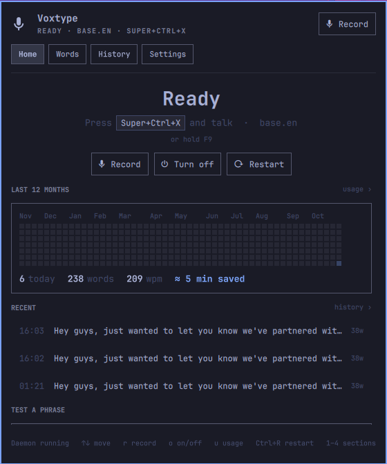
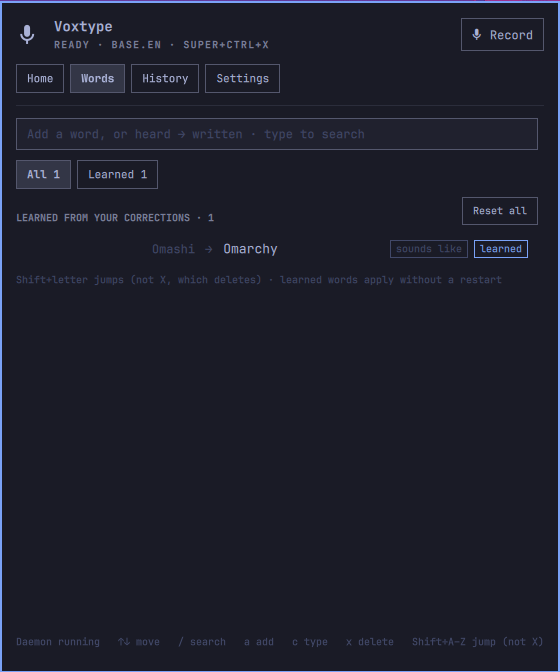
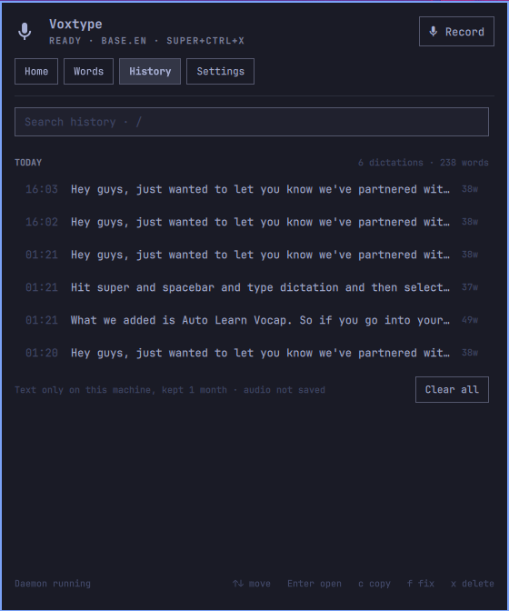
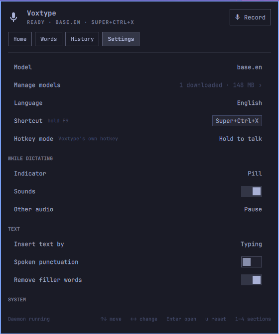
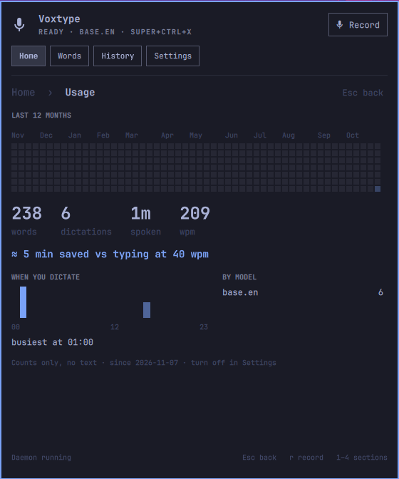

# Voxtype for Omarchy

A bar widget for **Omarchy Quattro** that manages [Voxtype](https://github.com/peteonrails/voxtype), Omarchy's bundled voice-to-text daemon: record, restart, your words, recent dictations, every setting, model downloads and backups — without opening `config.toml`.

| Home | Words | History |
|---|---|---|
|  |  |  |

| Settings | Home › Usage |
|---|---|
|  |  |

## Install

```bash
omarchy plugin add https://github.com/Zeus-Deus/voxtype-omarchy-plugin.git --enable --yes
```

To remove it again: `omarchy plugin remove io.github.zeus-deus.voxtype` (see [Uninstall](#uninstall)).

The widget lands in the right bar section; move it with `omarchy bar move`. Plugin settings (poll interval, right-click records) live under Setup › Plugins.

You need Voxtype itself and the `voxtype-tui` package (AUR: `voxtype-tui`) installed — see [Dependencies](#dependencies). If either is missing, the panel says so and offers an **Install** button that opens Omarchy's terminal and asks before installing anything. Nothing is downloaded or built when the plugin itself is installed.

## What the panel does

- **Bar button** with the live daemon state: idle, recording (accent), transcribing, stopped. Left-click opens the panel, right-click toggles recording, middle-click restarts a stale daemon. The tooltip is the hero line.
- **Home** — one word for the state (Ready, Listening, Off, Restart to apply), the shortcut that starts dictation (read from your Hyprland binds, so Omarchy's Super+Ctrl+X / F9 show up), Record, **Turn off / Turn on** and Restart, a missing-model banner, the year of dictations as a small heatmap with four numbers, your last three dictations, and a *test a phrase* field. `u` opens **Usage**: totals, words per minute, time saved versus typing, when you dictate and with which model.
- **Turn off / Turn on** (`o` on Home) stops the Voxtype service so its model leaves your GPU memory (or RAM on CPU) until you turn it back on. It is a plain `systemctl --user stop`: nothing is uninstalled or disabled, so Voxtype still starts at your next login. Turning on reloads the model (a few seconds for a large one). While it is off the hotkey does nothing and Restart will not quietly start it.
- **Words** — your vocabulary and dictionary rules in one list, *heard → written*: type `Codemux` to add a word, `code mucks → Codemux` to add a rule; the same field searches. Filter chips, A–Z jump (Shift+letter, not X: Shift+X deletes like `x`; Shift+R jumps here, `r` records), `c` cycles a rule between Replacement and Capitalization, `x` deletes (confirmed), and the prompt meter `n / 224` (amber at 200, urgent at 224). Words Voxtype **learned** from your corrections sit in their own group: Enter accepts, `p` adds one to your own words, `x` rejects, `d` forgets.
- **History** — dictations grouped by day, searchable. Open one to see the full text and, where your rules changed it, what Voxtype heard. **Copy**, **Delete**, **Clear all**, and **Fix a word**: pick the misheard word(s), type the right one, choose spelling / sounds like / replace, and Voxtype uses it from the next dictation on.
- **Settings** — the everyday rows first (model, language, shortcut, mode, indicator, sounds, other audio while dictating, how text is inserted, spoken punctuation, filler words, start at login, usage / history / archive / learning). Three drill-ins keep everything else one step away: **Manage models** (per-engine catalog, set active, download with progress and log tail, delete), **All Voxtype settings** (engine, hotkey, audio, output, voice activity, post-processing, remote Whisper with an *API key is set* indicator — the key is never entered or shown — indicator details, notifications, GPU) and **Backup** (Export… / Import… with a previewed diff). A drill-in shows how many of its settings you changed. Changes are written immediately and validated by the bridge; restart-sensitive ones light **Restart to apply**.
- Usage, History and learned words need **voxtype-tui 0.2** or newer; with an older one those parts say so and everything else works as before.
- Honest states: Voxtype not installed, voxtype-tui missing, installed but not set up (copyable `voxtype setup` hint — never run for you), daemon stopped, stale config, model missing, empty lists, bridge errors in the footer.

## Which model?

| You have | Pick | Custom words right | Word errors | Time per dictation |
|---|---|---:|---:|---:|
| A GPU | whisper `large-v3-turbo-q5_0` | 26/27 | 5.2% | 0.2 s |
| CPU only | Qwen3-ASR `0.6b-q8_0` | 24/27 | 5.6% | 1.2 s |
| A slower CPU | Qwen3-ASR `0.6b-q4_k` | 23/27 | 6.5% | 0.8 s |

Measured on one voice with a mid-range CPU and a high-end GPU, vocabulary and
dictionary on. Your results will vary.

## Keyboard

`1`–`4` jump to a section, `Tab`/`Shift+Tab` cycle, `↑↓`/`j k` move the cursor, `Enter`/`Space` activate, `←→` change a setting or nudge a slider, `/` or `Ctrl+F` focus search, `a` add, `c` copy (History) or cycle a rule's category (Words), `f` fix a word, `p` keep a learned word, `d` download (models) or forget (learned), `u` open Usage (Home) or reset a setting to its default, `x` delete, `r` toggle recording, `o` turn Voxtype off/on (Home), `Ctrl+R` restart the daemon. `Esc` steps back one level: out of a field, Fix, an open dictation or a drill-in, then closes the panel.

## Dependencies

An installed Omarchy Quattro shell (`qs.Ui` / `qs.Commons`), `voxtype`, `/usr/bin/python3` with the `voxtype-tui` package (AUR: `voxtype-tui`), `zenity` for the import file chooser, `wl-copy` (wl-clipboard) for the copy buttons, and `omarchy-launch-terminal` for the GPU sudo hand-off. The locked-state Install buttons use Omarchy's `omarchy-launch-floating-terminal-with-presentation`; without it they fall back to a copyable command. The panel says so in place when zenity or the terminal launcher is missing. Git is needed for plugin-manager installation. Node.js and pytest are only needed for the development tests.

No plugin-specific npm/pip packages, build step or vendored binaries. Nothing runs at install time, and the plugin itself never runs as root — the privileged actions (GPU enable/disable, and installing a missing Voxtype or voxtype-tui) open a terminal where *you* confirm and type any password, so the shell never handles one. Selecting Qwen3-ASR additionally uses voxtype-tui's managed local server and user service.

## How it works

It is an independently maintained native shell plugin built against the official Quattro plugin contract. It does not start another Quickshell instance and is not a first-party Omarchy product. Marketplace verification applies only to the approved source snapshot, not every newer upstream commit.

The panel is a thin QML front end over the installed **voxtype-tui** Python package. Every write goes through `voxtype_tui` (validated, atomic, comment-preserving saves; sidecar reconcile; sync bundle), so the panel and the TUI never disagree.

Some models in the list are added by **voxtype-tui 0.1.9 or newer** rather than shipped by Voxtype: quantized Whisper files that Voxtype loads directly (offered only with GPU acceleration, which they need), and **Qwen3-ASR**, which runs as a small local CrispASR server that Voxtype reaches through its remote mode and that starts and stops together with Voxtype. With an older voxtype-tui the panel simply lists Voxtype's own models.

Installing from a local checkout instead: `omarchy plugin add "$PWD" --yes --enable`.

## Security

Plugins run unsandboxed inside `omarchy-shell`, so:

- **This plugin makes no network connections of its own: no telemetry, no
  analytics, no version check.** User-requested model downloads are delegated
  to the `voxtype` binary or voxtype-tui's checksum-pinned downloader for
  extra models, with fixed argv and relayed progress output. While Qwen3-ASR
  is active, voxtype-tui also checks its local server's health on 127.0.0.1.
  Transcription itself belongs to Voxtype: Qwen3-ASR is local, while a remote
  Whisper endpoint you configure can send audio to that chosen server.
- It edits configuration, vocabulary and dictionary rules, and reads the
  daemon's state file. With voxtype-tui 0.2, voxtype-tui keeps a local
  history of your dictations (text only unless you turn on the archive;
  files are `0600`, pruned after the period you choose, never synced or
  exported). The panel reads it only to show History and Usage, and it never
  leaves the machine. It never records or reads audio itself.
- Every process is a fixed argv array. Untrusted strings travel over stdin as
  JSON, never through a shell. There is no `shell=True`, `eval` or string-built
  command anywhere in the plugin.
- The bridge response is capped at 2 MB and parsed strictly; a non-zero exit is
  never read as success.
- The remote API key is never read back into QML; the bridge only reports
  whether one is set. Clearing it is a normal `settings.unset`.
- Sudo-needing actions (GPU enable/disable) are handed to your own terminal via
  `omarchy-launch-terminal`, with a fixed argv in which no element is
  user-influenced. The panel has no password field and the shell never sees a
  credential.
- Export defaults to no secrets and can only write inside your home directory,
  to a `.json` path.
- Import defaults to **vocabulary and rules only**: settings from a bundle are
  opt-in behind a checkbox, the preview shows every row that would change, and
  dangerous changes (anything that runs a command, repoints transcription or
  moves where audio and text are written) must be accepted explicitly. The
  plugin keeps its own dangerous-path list as a superset of upstream's, so a
  gap there cannot silently widen the hole here.
- An import confirmation covers the preview you saw, not the file path. The
  preview returns a token over the exact file bytes, the import options and
  the resulting changes; Apply reads the file once more, recomputes it, and
  writes nothing if anything differs (for example, a sync peer replaced
  `sync.json` with one that adds a command). The panel then shows the new
  preview and asks again.
- Automatic sync uses the same dangerous-path boundary before loading peer
  settings. Commands, remote transcription destinations, capture/output paths
  and the entire secrets block are not accepted automatically; vocabulary,
  dictionary rules and safe settings still sync. A warning names ignored
  paths. To accept them, use Import with settings enabled and confirm the
  dangerous changes. A later ordinary save regenerates `sync.json` from
  accepted local state, so import first or retain a separate source bundle.
- Destructive actions confirm with **Cancel** selected by default.
- **The shell never reads your clipboard.** Qt's editable text inputs (the
  kit's `TextField` and the spin box inside `NumberField`) fetch the whole
  clipboard text inside the shell on every clipboard change and on paste,
  with no size limit and no overall deadline, so a program owning the
  clipboard could stall or fill the shared shell. Every field in this panel
  is `EditField.qml` instead: a plain-text `TextEdit` that only checks which
  formats are offered, with Ctrl+V, Shift+Insert, middle-click and the
  context menu closed. A paste runs `bridge.py --paste` in a child process
  (`wl-paste`, at most 16 KB, 2 s in total, its process group killed
  afterwards) and inserts the text only into the field that asked, if it
  still has focus. Anything larger, slower or not text is refused with a
  notice and nothing is inserted.

### What a reviewer will flag

An automated baseline scan will detect two capabilities in this plugin. Both are
intentional and visible in the source:

- **`privilege`** — one `sudo` reference, at `Service.qml:244`. It is a fixed
  argv (`omarchy-launch-terminal sudo voxtype setup gpu --enable|--disable`)
  in which no element comes from user input or a config file. It is detached
  into your terminal so the credential is typed by you, to `sudo`, outside
  `omarchy-shell` entirely. There is no sudoers file, no `NOPASSWD` rule, and
  no password field anywhere in the plugin.
- **`service-management`** — `systemctl --user start|stop|restart voxtype` and
  a read-only `systemctl --user show voxtype`. The verb is chosen from a fixed
  set in `bridge.py`; it is never taken from the request JSON. This is how the
  panel starts, stops and restarts the voice daemon, which is the plugin's
  purpose. **Turn off / Turn on** is exactly `stop` / `start`; it does not
  enable, disable or mask the Voxtype service, so its start-at-login setting
  is unchanged. Selecting Qwen3-ASR delegates creation and enabling of
  `voxtype-asr.service` to voxtype-tui. Switching away queues teardown;
  voxtype-tui 0.1.9 disables and removes that managed unit after a verified
  Voxtype restart, keeping the old daemon's helper available until then.
  Its lifecycle follows Voxtype.

There are no bundled binaries or installer scripts in this repository.
Extra-model downloads and the digest-pinned CrispASR server build are managed
by voxtype-tui 0.1.9 or newer, not by a plugin install hook. The bridge itself
runs as `/usr/bin/python3` against this repository; ordinary operations call
binaries already installed on the system.

**Missing-dependency install button.** When Voxtype or `voxtype-tui` is not
installed, the locked panel offers an Install button (`Service.qml:255`). It
opens Omarchy's own floating terminal
(`omarchy-launch-floating-terminal-with-presentation`, the launcher Omarchy's
first-run "Install Dictation" notification uses) with one of two fixed scripts
from `Model.js` `INSTALL_SCRIPTS`: `omarchy install dictation voxtype`, or
`omarchy pkg aur add voxtype-tui` behind a `gum confirm` prompt. The panel
chooses between them by locked-state kind and launches nothing for any other
value; nothing in either script comes from the bridge, the config or user
input. You answer the prompt and type any password in that terminal, and
nothing is installed if you say no. The same command is shown as a copy button
for anyone who prefers to run it themselves.

## Uninstall

```bash
omarchy plugin remove io.github.zeus-deus.voxtype
```

That removes the plugin and its bar widget. It does not touch Voxtype itself,
your `config.toml`, your vocabulary or your dictionary rules — the plugin keeps
no state of its own outside the shell's plugin settings (poll interval,
right-click-records).

## Development

```bash
node --test tests/*.test.js
uv run --python /usr/bin/python3 --with pytest pytest -q tests/
qmllint -I /usr/share/omarchy/shell BarWidget.qml Panel.qml Service.qml VoxtypeIcon.qml EditField.qml
omarchy plugin validate .
omarchy-restart-shell && qs log -p /usr/share/omarchy/shell --tail 60
```

`docs/DESIGN.md` is the specification, including the bridge protocol. `docs/DEVELOPMENT.md` records the conventions and traps.

## License

MIT — see `LICENSE`.
